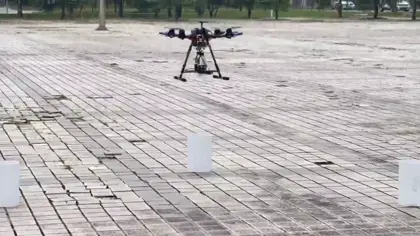
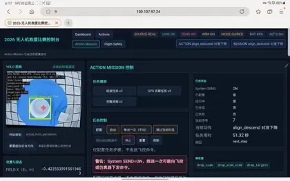
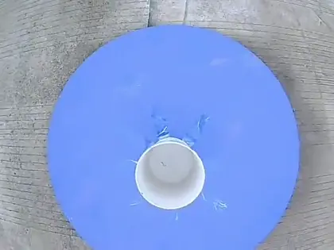
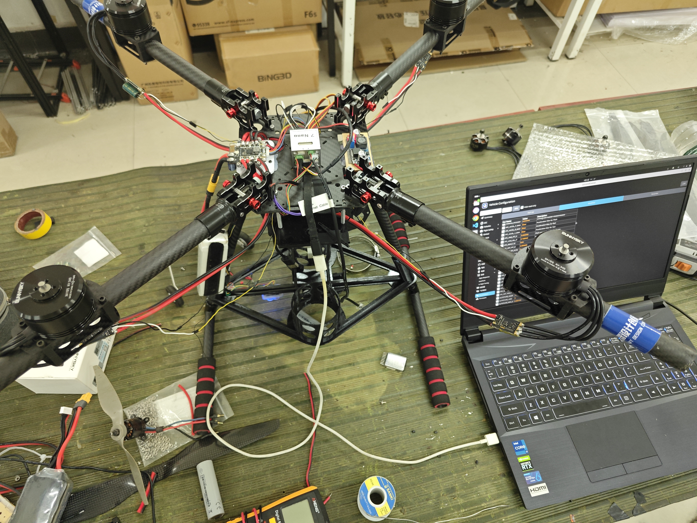
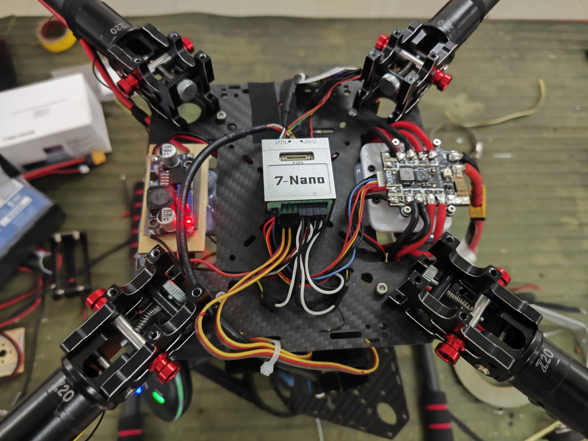

# CUADC 2026 多旋翼侦察与救援自主无人机

基于 **RK3588 + ArduPilot + YOLO/RKNN** 的低成本自主无人机参考实现。

面向 CUADC 多旋翼侦察与救援任务，实现目标识别与定位、自动投放、区域侦察、返航和
视觉辅助降落。


[功能演示](#功能演示) · [从零复现](docs/beginner/01_preface.md) · [开发者文档](docs/developer/README.md)

> [!WARNING]
> 本项目可以连接真实飞控并发送飞行和舵机控制命令。首次部署和调试请拆除螺旋桨和载荷，
> 并先完成 SITL 与安全检查。详见[安全边界](docs/developer/safety.md)。

## 项目简介

本项目为 CUADC 2026 多旋翼无人机侦察与救援比赛开发。使用 RK3588 作为机载
计算平台，ArduPilot 负责底层飞行控制，下视相机配合 YOLO/RKNN 完成视觉感知，并通过
MAVLink 连接飞控和机载计算机。

RK3588 负责视觉、任务和 Web UI；飞控负责稳定、动力与执行机构控制。目标是以相对
低成本的硬件和清晰的系统分工，完成一套可用于比赛开发、复现和继续改进的自主任务方案。

## 项目来源

本项目由西安石油大学航模社在首次参加 CUADC 多旋翼无人机侦察与救援项目过程中开发。

作为第一次参加比赛，我们在视觉识别、目标定位、自动投放、
场地坐标和实飞调试中踩过不少坑，也留下了一些尚未完善的代码和工程设计。

因此决定将项目开源，希望它能为其他第一次接触自主无人机或参加类似比赛的学生团队
提供一个可以参考、复现和继续改进的起点。


## 功能演示

当前项目包含以下能力：

- 目标识别与跟踪
- 目标 GPS 粗定位（双目标分项支持多视角采集）
- 双目标自动投放
- 区域侦察航迹与实时识别
- 自动返航
- H 标志视觉辅助降落
- Web UI 操作界面
- ArduPilot + Gazebo SITL 仿真

[完整比赛飞行视频](docs/assets/readme/flight-demo.mp4)



[Web UI 操作实录](docs/assets/readme/webui-demo.mp4)



[国赛比赛投弹视频](docs/assets/readme/payload-drop-demo.mp4)



飞机照片





### YOLO 识别


### Web UI


### Gazebo SITL


## 比赛任务

当前完整流程由
[`rescue_2026_full_auto.json`](config/action_missions/rescue_2026_full_auto.json)
定义：

```text
场地初始化
  ↓
起飞
  ↓
投放区中心识别与定位
  ↓
目标选择与自动投放
  ↓
侦察区航迹（实时识别）
  ↓
返航
  ↓
视觉辅助降落
```

任务模板是比赛开发的当前实现，不代表已经适配所有机型、场地或比赛规则版本。

## 项目特点

### 低成本

使用 RK3588 作为机载计算平台，搭配普通下视相机和普通 GPS，没有使用图传、数传、深度相机或激光雷达。

### 简单架构

底层飞控与高级任务分离：

```text
RK3588 → MAVLink → ArduPilot
```

飞控负责稳定与底层控制，RK3588 负责感知和高级任务。

### RK3588 NPU 本地视觉

YOLO 使用 RKNNLite 在 RK3588 NPU 本地运行，减少对云端视觉服务的依赖。

### Action Mission

起飞、航点、定位、投放、侦察和降落等能力以 Action 组合为比赛任务。

### Web UI

浏览器可用于查看状态、初始化比赛场地、测试 Action 和运行 Mission。

启动前需设置操作者口令环境变量 `UAV_WEB_OPERATOR_PASSWORD`（或 `UAV_WEB_OPERATOR_PASSWORD_FILE`
指向权限受限的凭据文件），不要将口令写入受 Git 跟踪的 YAML。

### SITL

支持 ArduPilot + Gazebo 仿真验证，帮助团队在实飞前检查任务流程和异常路径。

## 系统架构

```text
下视相机
    │
    ▼
YOLO / RKNN
    │
    ▼
RK3588
感知 + Action Mission + Web UI
    │
    │ MAVLink
    ▼
ArduPilot
    │
    ▼
电机 / GPS / 投放机构
```

架构边界、任务接口和通信说明见[开发者文档](docs/developer/README.md)。

## 当前状态与已知限制

> 本项目来自学生竞赛开发，目前仍在持续整理和改进，并不是经过工业级验证的通用自主
> 飞行框架。

- 主要围绕 CUADC 2026 比赛任务设计；
- 当前机载部署主要面向 Linux ARM64 RK3588；
- 通用 app 可在 Linux x86_64/ARM64 上用于开发、SITL 和 Web 操作；本地 RKNN YOLO
  仍只支持 RK3588，见[平台与环境支持](docs/developer/platform_support.md)；
- 部分视觉、投放和飞行参数需要根据不同飞机重新标定；
- SITL 与真实飞行仍存在差异；
- 任务级流程已由原子 Action 和 Action Mission 模板表达；
- 当前正式侦察模板尚未接入自动采集、融合、危险标识排名和报告生成；
- 自动化测试覆盖仍需要提升；
- 飞行安全、异常恢复和边界情况仍有继续完善空间；
- 文档仍在持续整理。

如果你发现问题，欢迎提交 [Issue](https://github.com/Bob12315/cuadc2026/issues) 或
[Pull Request](https://github.com/Bob12315/cuadc2026/pulls)。

## 文档

### 🚁 从零复现

适合第一次接触本项目、希望搭建完整系统的读者：

1. [前言](docs/beginner/01_preface.md)
2. [配置清单](docs/beginner/02_hardware_bom.md)
3. [RK3588 环境配置](docs/beginner/03_rk3588_setup.md)
4. [SITL 测试](docs/beginner/04_sitl_test.md)
5. [实飞测试](docs/beginner/05_flight_test.md)

### 👨‍💻 开发者

希望理解架构、修改 Action 或 Mission，请阅读[开发者文档](docs/developer/README.md)。

### 🤖 AI / Coding Agent

使用 Codex、Claude Code 等工具接管和维护代码前，请阅读
[AI 开发入口](docs/ai/README.md)。

完整目录见[文档索引](docs/README.md)。

## 硬件概览

| 部分 | 当前方案 |
| --- | --- |
| 飞控 | ArduPilot |
| 机载计算 | RK3588 |
| 视觉 | 下视相机 + YOLO/RKNN |
| 通信 | MAVLink |
| 操作界面 | Web UI |
| 投放 | 双路 Servo |

装机型号与参考价格见[硬件配置清单](docs/beginner/02_hardware_bom.md)。复现时应按实际采购
和装机情况复核，不能只从软件配置推断硬件型号。

## 快速开始

```bash
git clone https://github.com/Bob12315/cuadc2026.git
cd cuadc2026
```

完整安装和部署请从[RK3588 环境配置](docs/beginner/03_rk3588_setup.md)开始。
